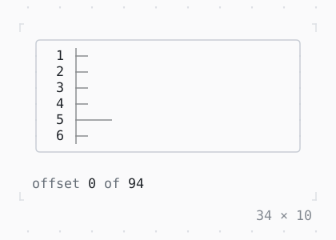

# Scrollable

What scrolls a viewport: here one of the page's own, a ruler that tells the scrollable how long it is as it is laid out.

| Dark | Light |
| --- | --- |
|  |  |

## Code

The Dart that builds it, as the gallery's Code tab shows it with the
options as they start:

```dart
final _controller = ScrollController();

@override
void dispose() {
  _controller.dispose();
  super.dispose();
}

@override
Widget build(BuildContext context) {
  final theme = Theme.of(context);
  return Column(
    mainAxisSize: .min,
    crossAxisAlignment: .start,
    gap: 1,
    children: [
      SizedBox(
        width: 34,
        height: 8,
        // the border primary while the focus is in it
        child: FocusBuilder(
          builder: (context, hasFocus, child) => Box(
            border: .all(
              type: .rounded,
              style: hasFocus ? theme.primary : theme.border,
            ),
            child: child,
          ),
          child: Scrollable(
            controller: _controller,
            viewportBuilder: (context, position) => ListenableBuilder(
              listenable: position,
              builder: (_, _) =>
                  _Ruler(position, offset: position.offset, length: 100),
            ),
          ),
        ),
      ),
      ListenableBuilder(
        listenable: _controller,
        builder: (context, _) => Text.rich([
          Span('offset ', theme.muted),
          Span('${_controller.offset}'),
          Span(' of ', theme.muted),
          Span('${_controller.position.maxOffset}'),
        ]),
      ),
    ],
  );
}

/// A viewport of [length] numbered rows from [offset] on, which tells
/// [position] its extents as it is laid out.
final class _Ruler extends LeafRenderObjectWidget {
  const _Ruler(this.position, {required this.offset, required this.length});

  final ScrollPosition position;
  final int offset;
  final int length;

  @override
  _RenderRuler createRenderObject(BuildContext context) =>
      _RenderRuler(position, offset, length);

  @override
  void updateRenderObject(BuildContext context, _RenderRuler renderObject) =>
      renderObject
        ..position = position
        ..offset = offset
        ..length = length;
}

final class _RenderRuler extends RenderObject {
  _RenderRuler(this._position, this._offset, this._length);

  ScrollPosition _position;
  int _offset;
  int _length;

  set position(ScrollPosition value) {
    if (value != _position) {
      _position = value;
      markNeedsLayout();
    }
  }

  set offset(int value) {
    if (value != _offset) {
      _offset = value;
      markNeedsPaint();
    }
  }

  set length(int value) {
    if (value != _length) {
      _length = value;
      markNeedsLayout();
    }
  }

  @override
  void performLayout(BoxConstraints c) {
    width = c.maxW;
    height = c.maxH;
    _position.applyExtents(height, _length);
  }

  @override
  void paint(PaintContext ctx) {
    final canvas = ctx.canvas;
    final pen = canvas.styles.pen(const Pen());
    final tick = canvas.styles.pen(const Pen(attrs: Attr.dim));
    for (var y = 0; y < height && _offset + y < _length; y++) {
      final row = _offset + y + 1;
      final x = canvas.text(0, y, '${row.toString().padLeft(3)} ', pen);
      canvas.text(
        x,
        y,
        row % 10 == 0 ? '├─────────' : (row % 5 == 0 ? '├────' : '├─'),
        tick,
      );
    }
  }
}
```

## More

- API: [`Scrollable`](https://pub.dev/documentation/twk/latest/twk/Scrollable-class.html).
- Also in Scrolling: [SingleChildScrollView](singlechildscrollview.md), [ListView](listview.md), [LogView](logview.md), [Scrollbar](scrollbar.md).
- Live in the gallery:
  `dart run packages/gallery/bin/gallery.dart --route='#/scrolling/scrollable'`.
- [Scrolling](../scrolling.md) · [All groups](../README.md)
