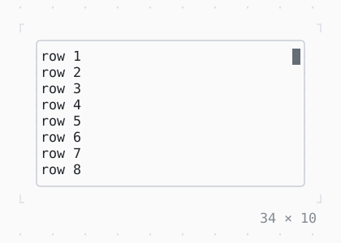

# Scrollbar

A bar by the scrollable below it, its thumb where the window is; the thumb dragged and the track clicked scroll it.

| Dark | Light |
| --- | --- |
|  |  |

## Code

The Dart that builds it, as the gallery's Code tab shows it with the
options as they start:

```dart
@override
Widget build(BuildContext context) {
  final theme = Theme.of(context);
  return SizedBox(
    width: 34,
    height: 10,
    // the border primary while the focus is in it
    child: FocusBuilder(
      builder: (context, hasFocus, child) => Box(
        border: .all(
          type: .rounded,
          style: hasFocus ? theme.primary : theme.border,
        ),
        child: child,
      ),
      child: Scrollbar(
        child: ListView.builder(
          itemCount: 200,
          itemBuilder: (context, i) => Text('row ${i + 1}'),
        ),
      ),
    ),
  );
}
```

## Options

What the gallery lets you change, and what each starts at:

| option | values | starts at |
| --- | --- | --- |
| visibility | always, onScroll, never | always |
| bars | vertical, horizontal, both | vertical |
| style | muted, border, primary, accent | muted |
| slim | on, off | false |
| track | faint, border, muted | faint |

## More

- API: [`Scrollbar`](https://pub.dev/documentation/twk/latest/twk/Scrollbar-class.html).
- Also in Scrolling: [SingleChildScrollView](singlechildscrollview.md), [Scrollable](scrollable.md), [ListView](listview.md), [LogView](logview.md).
- Live in the gallery:
  `dart run packages/gallery/bin/gallery.dart --route='#/scrolling/scrollbar'`.
- [Scrolling](../scrolling.md) · [All groups](../README.md)
