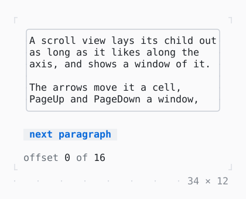

# SingleChildScrollView

One child scrolled in the room it is given: Tab to it, then the arrows, PageUp and PageDown, or the wheel over it.

| Dark | Light |
| --- | --- |
|  |  |

## Code

The Dart that builds it, as the gallery's Code tab shows it with the
options as they start:

```dart
const _paragraphs = [
  'A scroll view lays its child out as long as it likes along the axis, and '
      'shows a window of it.',
  'The arrows move it a cell, PageUp and PageDown a window, Home and End to '
      'the ends.',
  'A notch of the wheel over it scrolls three cells.',
  'Scrolled while all of it is on the screen, it has the terminal move the '
      'rows that stay.',
  'A Column in it is as tall as its children, whatever its mainAxisSize.',
  'Its controller reads the offset and moves it; the line under the box '
      'listens to it.',
];

final _controller = ScrollController();
final _keys = [for (final _ in _paragraphs) GlobalKey()];
var _shown = -1;

@override
void dispose() {
  _controller.dispose();
  super.dispose();
}

/// Lights the next paragraph and scrolls the least that shows it.
void _showNext() {
  setState(() => _shown = (_shown + 1) % _paragraphs.length);
  _controller.ensureVisible(_keys[_shown].currentContext!);
}

@override
Widget build(BuildContext context) {
  final theme = Theme.of(context);
  final paragraphs = [
    for (final (i, text) in _paragraphs.indexed)
      Text(
        text,
        key: _keys[i],
        style: i == _shown ? theme.primary : const Style(),
      ),
  ];
  return Column(
    mainAxisSize: .min,
    crossAxisAlignment: .start,
    gap: 1,
    children: [
      SizedBox(
        width: 34,
        height: 8,
        // the border primary while the focus is in it
        child: FocusBuilder(
          builder: (context, hasFocus, child) => Box(
            border: .all(
              type: .rounded,
              style: hasFocus ? theme.primary : theme.border,
            ),
            child: child,
          ),
          child: SingleChildScrollView(
            controller: _controller,
            child: Column(
              crossAxisAlignment: .start,
              gap: 1,
              children: paragraphs,
            ),
          ),
        ),
      ),
      Button('next paragraph', onPressed: _showNext),
      ListenableBuilder(
        listenable: _controller,
        builder: (context, _) => Text.rich([
          Span('offset ', theme.muted),
          Span('${_controller.offset}'),
          Span(' of ', theme.muted),
          Span('${_controller.position.maxOffset}'),
        ]),
      ),
    ],
  );
}
```

## Options

What the gallery lets you change, and what each starts at:

| option | values | starts at |
| --- | --- | --- |
| direction | vertical, horizontal | vertical |

## More

- API: [`SingleChildScrollView`](https://pub.dev/documentation/twk/latest/twk/SingleChildScrollView-class.html).
- Also in Scrolling: [Scrollable](scrollable.md), [ListView](listview.md), [LogView](logview.md), [Scrollbar](scrollbar.md).
- Live in the gallery:
  `dart run packages/gallery/bin/gallery.dart --route='#/scrolling/singlechildscrollview'`.
- [Scrolling](../scrolling.md) · [All groups](../README.md)
