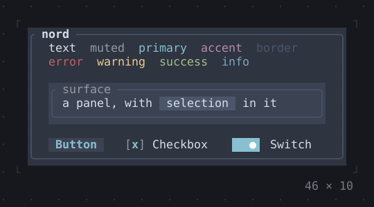
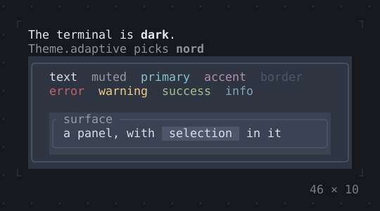
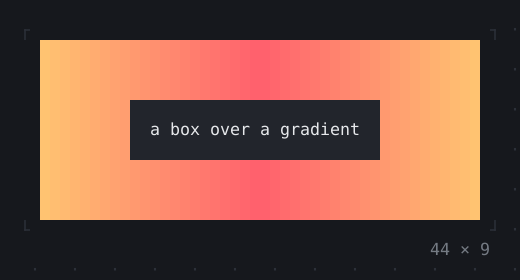
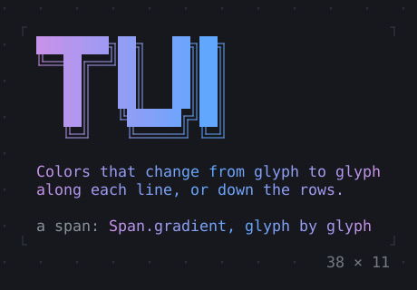

# Style

Themes, the terminal’s brightness, and colors that run across a background or text.

[All groups](README.md)

| | |
| --- | --- |
|  **[Theme](style/theme.md)** The styles of an app by what they are for, which the widgets below it draw in: a preset, or the terminal's own colors. |  **[TerminalBrightness](style/terminalbrightness.md)** Whether the terminal is dark or light, as it reports it; Theme.adaptive picks a dark or a light theme by it. |
|  **[GradientBackground](style/gradientbackground.md)** A background whose color changes from cell to cell, along the columns or down the rows, from stop to stop. |  **[GradientForeground](style/gradientforeground.md)** Text whose color changes from glyph to glyph along each line, or from line to line down the rows. |

