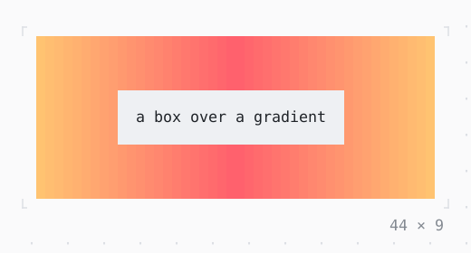

# GradientBackground

A background whose color changes from cell to cell, along the columns or down the rows, from stop to stop.

| Dark | Light |
| --- | --- |
|  |  |

## Code

The Dart that builds it, as the gallery's Code tab shows it with the
options as they start:

```dart
const _colors = [
  Color.rgb(0xff, 0x5f, 0x6d),
  Color.rgb(0xff, 0xc3, 0x71),
];

final class _BackdropState extends State<_Backdrop>
    with TickerProviderStateMixin {
  late final _flow = AnimationController(
    vsync: this,
    duration: const Duration(milliseconds: 4000),
  )..repeat();

  @override
  void dispose() {
    _flow.dispose();
    super.dispose();
  }

  @override
  Widget build(BuildContext context) {
    return ListenableBuilder(
      listenable: _flow,
      builder: (context, _) {
        final gradient = Gradient(
          _colors,
          phase: _flow.value,
          direction: .horizontal,
        );
        return GradientBackground(
          gradient: gradient,
          child: SizedBox(
            width: 44,
            height: 9,
            child: Center(
              child: Box(
                style: Theme.of(context).surface,
                padding: const .only(left: 2, top: 1, right: 2, bottom: 1),
                child: const Text('a box over a gradient'),
              ),
            ),
          ),
        );
      },
    );
  }
}
```

## Options

What the gallery lets you change, and what each starts at:

| option | values | starts at |
| --- | --- | --- |
| colors | theme, sunset, ocean, palette | sunset |
| direction | columns, rows | columns |
| stops | even, inset, early | even |
| flow | on, off | true |

## More

- API: [`GradientBackground`](https://pub.dev/documentation/twk/latest/twk/GradientBackground-class.html).
- Also in Style: [Theme](theme.md), [TerminalBrightness](terminalbrightness.md), [GradientForeground](gradientforeground.md).
- Live in the gallery:
  `dart run packages/gallery/bin/gallery.dart --route='#/style/gradientbackground'`.
- [Style](../style.md) · [All groups](../README.md)
