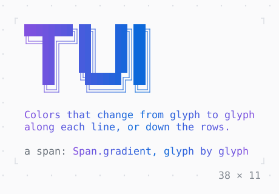

# GradientForeground

Text whose color changes from glyph to glyph along each line, or from line to line down the rows.

| Dark | Light |
| --- | --- |
|  |  |

## Code

The Dart that builds it, as the gallery's Code tab shows it with the
options as they start:

```dart
final class _LetteringState extends State<_Lettering>
    with TickerProviderStateMixin {
  late final _flow = AnimationController(
    vsync: this,
    duration: const Duration(milliseconds: 4000),
  )..repeat();

  @override
  void dispose() {
    _flow.dispose();
    super.dispose();
  }

  @override
  Widget build(BuildContext context) {
    final theme = Theme.of(context);
    final colors = [theme.primary.fg!, theme.accent.fg!];
    return ListenableBuilder(
      listenable: _flow,
      builder: (context, _) {
        final gradient = Gradient(
          colors,
          phase: _flow.value,
          direction: .horizontal,
        );
        return Column(
          mainAxisSize: .min,
          crossAxisAlignment: .start,
          gap: 1,
          children: [
            GradientForeground(
              gradient: gradient,
              child: const Text(
                '████████╗██╗   ██╗██╗\n'
                '╚══██╔══╝██║   ██║██║\n'
                '   ██║   ██║   ██║██║\n'
                '   ██║   ██║   ██║██║\n'
                '   ██║   ╚██████╔╝██║\n'
                '   ╚═╝    ╚═════╝ ╚═╝\n'
                '\n'
                'Colors that change from glyph to glyph\n'
                'along each line, or down the rows.'
              ),
            ),
            Text.rich([
              Span('a span: ', Theme.of(context).muted),
              'Span.gradient, glyph by glyph'.gradient(gradient),
            ]),
          ],
        );
      },
    );
  }
}
```

## Options

What the gallery lets you change, and what each starts at:

| option | values | starts at |
| --- | --- | --- |
| colors | theme, sunset, ocean, palette | theme |
| direction | columns, rows | columns |
| stops | even, inset, early | even |
| flow | on, off | true |

## More

- API: [`GradientForeground`](https://pub.dev/documentation/twk/latest/twk/GradientForeground-class.html).
- Also in Style: [Theme](theme.md), [TerminalBrightness](terminalbrightness.md), [GradientBackground](gradientbackground.md).
- Live in the gallery:
  `dart run packages/gallery/bin/gallery.dart --route='#/style/gradientforeground'`.
- [Style](../style.md) · [All groups](../README.md)
