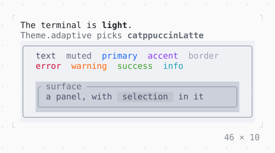

# TerminalBrightness

Whether the terminal is dark or light, as it reports it; Theme.adaptive picks a dark or a light theme by it.

| Dark | Light |
| --- | --- |
|  |  |

## Code

The Dart that builds it, as the gallery's Code tab shows it with the
options as they start:

```dart
// the brightness the terminal reports, which the app puts at its top
return const _Adaptive();

/// The brightness found here, and the theme [Theme.adaptive] picks by it.
final class _Adaptive extends StatelessWidget {
  const _Adaptive();

  @override
  Widget build(BuildContext context) {
    final brightness = TerminalBrightness.of(context);
    return Column(
      mainAxisSize: .min,
      crossAxisAlignment: .start,
      children: [
        Text.rich([
          const Span('The terminal is '),
          brightness.name.bold,
          const Span('.'),
        ]),
        Text.rich([
          const Span('Theme.adaptive picks '),
          switch (brightness) {
            Brightness.dark => 'nord'.bold,
            Brightness.light => 'catppuccinLatte'.bold,
          },
        ], style: Theme.of(context).muted),
        const Theme.adaptive(
          dark: ThemeData.nord,
          light: ThemeData.catppuccinLatte,
          child: _Swatches(),
        ),
      ],
    );
  }
}

/// Each style of the theme, named in it, on its background.
final class _Swatches extends StatelessWidget {
  const _Swatches();

  @override
  Widget build(BuildContext context) {
    final theme = Theme.of(context);
    final text = [
      ('text', theme.text),
      ('muted', theme.muted),
      ('primary', theme.primary),
      ('accent', theme.accent),
      ('border', theme.border),
    ];
    final status = [
      ('error', theme.error),
      ('warning', theme.warning),
      ('success', theme.success),
      ('info', theme.info),
    ];
    return SizedBox(
      width: 46,
      child: Box(
        style: theme.background.merge(theme.text),
        border: .all(type: .rounded, style: theme.border),
        padding: const .x(2),
        child: Column(
          mainAxisSize: .min,
          crossAxisAlignment: .stretch,
          children: [
            Text.rich([
              for (final (name, style) in text) Span('$name  ', style),
            ]),
            Text.rich([
              for (final (name, style) in status) Span('$name  ', style),
            ]),
            const SizedBox(height: 1),
            Box(
              style: theme.surface,
              border: .all(type: .rounded, style: theme.border),
              titles: [BorderTitle(' surface ', style: theme.muted)],
              padding: const .x(1),
              child: Text.rich([
                const Span('a panel, with '),
                Span(' selection ', theme.selection),
                const Span(' in it'),
              ]),
            ),
          ],
        ),
      ),
    );
  }
}
```

## Options

What the gallery lets you change, and what each starts at:

| option | values | starts at |
| --- | --- | --- |
| brightness | the terminal's, dark, light | the terminal's |
| dark theme | nord, dark, mocha | nord |
| light theme | latte, light | latte |

## More

- API: [`TerminalBrightness`](https://pub.dev/documentation/twk/latest/twk/TerminalBrightness-class.html).
- Also in Style: [Theme](theme.md), [GradientBackground](gradientbackground.md), [GradientForeground](gradientforeground.md).
- Live in the gallery:
  `dart run packages/gallery/bin/gallery.dart --route='#/style/terminalbrightness'`.
- [Style](../style.md) · [All groups](../README.md)
