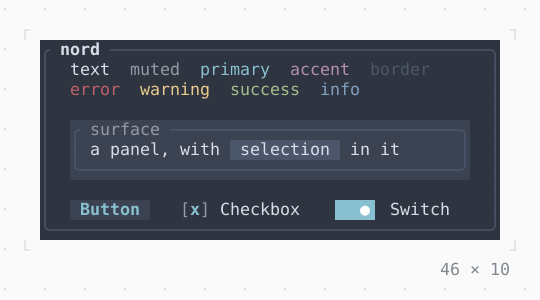

# Theme

The styles of an app by what they are for, which the widgets below it draw in: a preset, or the terminal's own colors.

| Dark | Light |
| --- | --- |
|  |  |

## Code

The Dart that builds it, as the gallery's Code tab shows it with the
options as they start:

```dart
const _themes = [
  ('terminal', ThemeData.terminal(Brightness.dark)),
  ('dark', ThemeData.dark),
  ('light', ThemeData.light),
  ('nord', ThemeData.nord),
  ('catppuccinMocha', ThemeData.catppuccinMocha),
  ('catppuccinLatte', ThemeData.catppuccinLatte),
];

final (name, data) = _themes[3];
return Theme(data: data, child: _Swatches(name));

/// Each style of the theme, named in it, on its background.
final class _Swatches extends StatefulWidget {
  const _Swatches(this.name);

  final String name;

  @override
  State<_Swatches> createState() => _SwatchesState();
}

final class _SwatchesState extends State<_Swatches> {
  var _checked = true;
  var _on = true;

  @override
  Widget build(BuildContext context) {
    final theme = Theme.of(context);
    final text = [
      ('text', theme.text),
      ('muted', theme.muted),
      ('primary', theme.primary),
      ('accent', theme.accent),
      ('border', theme.border),
    ];
    final status = [
      ('error', theme.error),
      ('warning', theme.warning),
      ('success', theme.success),
      ('info', theme.info),
    ];
    return SizedBox(
      width: 46,
      child: Box(
        style: theme.background.merge(theme.text),
        border: .all(type: .rounded, style: theme.border),
        titles: [
          BorderTitle(' ${widget.name} ', style: theme.text.merge(bold)),
        ],
        padding: const .x(2),
        child: Column(
          mainAxisSize: .min,
          crossAxisAlignment: .stretch,
          children: [
            Text.rich([
              for (final (name, style) in text) Span('$name  ', style),
            ]),
            Text.rich([
              for (final (name, style) in status) Span('$name  ', style),
            ]),
            const SizedBox(height: 1),
            Box(
              style: theme.surface,
              border: .all(type: .rounded, style: theme.border),
              titles: [BorderTitle(' surface ', style: theme.muted)],
              padding: const .x(1),
              child: Text.rich([
                const Span('a panel, with '),
                Span(' selection ', theme.selection),
                const Span(' in it'),
              ]),
            ),
            const SizedBox(height: 1),
            Row(
              gap: 3,
              children: [
                Button('Button', onPressed: () {}),
                Checkbox(
                  value: _checked,
                  label: 'Checkbox',
                  onChanged: (value) => setState(() => _checked = value),
                ),
                Switch(
                  value: _on,
                  label: 'Switch',
                  onChanged: (value) => setState(() => _on = value),
                ),
              ],
            ),
          ],
        ),
      ),
    );
  }
}

const bold = Style(attrs: Attr.bold);
```

## Options

What the gallery lets you change, and what each starts at:

| option | values | starts at |
| --- | --- | --- |
| theme | terminal, dark, light, nord, mocha, latte | nord |
| cycle | on, off | false |

## More

- API: [`Theme`](https://pub.dev/documentation/twk/latest/twk/Theme-class.html).
- Also in Style: [TerminalBrightness](terminalbrightness.md), [GradientBackground](gradientbackground.md), [GradientForeground](gradientforeground.md).
- Live in the gallery:
  `dart run packages/gallery/bin/gallery.dart --route='#/style/theme'`.
- [Style](../style.md) · [All groups](../README.md)
