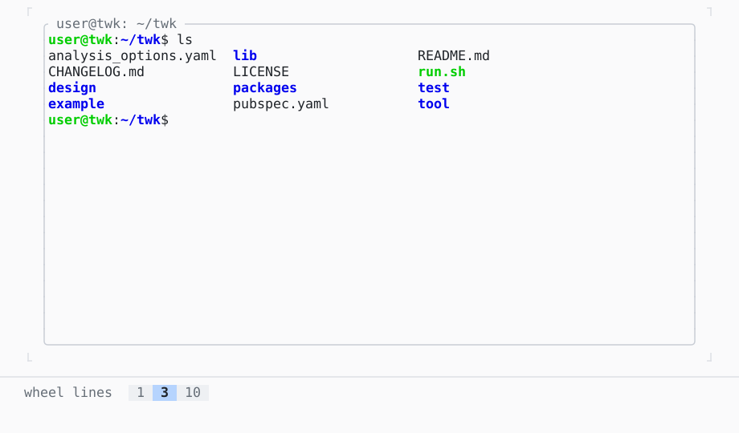

# TerminalView

A program's terminal in a view: keys, pastes, the mouse and resizes sent to it, its scrollback scrolled; here a scripted shell, not a program in a pseudo-terminal.

| Dark | Light |
| --- | --- |
|  |  |

In [twk_term](../../../packages/twk_term/README.md), besides twk.

## Code

The Dart that builds it, as the gallery's Code tab shows it with the
options as they start:

```dart
// ScriptedShell is the gallery's own: a fake bash at the other end of
// a byte link, which writes what bash would and answers the keys it
// is sent (ls, git log, dart test, htop, clear, help), typing its
// script until a key takes it over. A real shell is
// TerminalSession.start('bash', const []).
import 'scripted_shell.dart';

late var _session = _start();
final _focus = FocusNode(debugLabel: 'shell');
var _title = '';
Timer? _restart;

TerminalSession _start() {
  final shell = ScriptedShell(autoplay: true);
  final session = TerminalSession(
    output: shell.output,
    input: shell.input,
    onResize: shell.resize,
  );
  // when it exits: 'ended' for 700 ms, then another shell
  session.exitCode.then((_) {
    if (!mounted) return;
    setState(() => _title = 'ended');
    _restart = Timer(const Duration(milliseconds: 700), () {
      final ended = _session;
      setState(() {
        _session = _start();
        _title = '';
      });
      ended.dispose();
    });
  });
  return session;
}

@override
void initState() {
  super.initState();
  _focus.addListener(() => setState(() {}));
}

@override
void dispose() {
  _restart?.cancel();
  _session.dispose();
  _focus.dispose();
  super.dispose();
}

@override
Widget build(BuildContext context) {
  final theme = Theme.of(context);
  final focused = _focus.hasFocus;
  return SizedBox(
    width: 56,
    height: 26,
    child: Box(
      border: .all(
        type: .rounded,
        style: focused ? theme.primary : theme.border,
      ),
      titles: [
        BorderTitle(
          ' ${_title.isEmpty ? 'shell' : _title} ',
          style: focused ? theme.text : theme.muted,
        ),
      ],
      child: TerminalView(
        session: _session,
        focusNode: _focus,
        // the gallery's own: Tab and Esc move the focus, Ctrl+P searches
        ignoredKeys: const ['tab', 'shift+tab', 'escape', 'ctrl+p'],
        onTitleChanged: (title) => setState(() => _title = title),
      ),
    ),
  );
}
```

## Options

What the gallery lets you change, and what each starts at:

| option | values | starts at |
| --- | --- | --- |
| wheel lines | 1, 3, 10 | 3 |

## More

- Live in the gallery:
  `dart run packages/gallery/bin/gallery.dart --route='#/terminal/terminalview'`.
- [Terminal](../terminal.md) · [All groups](../README.md)
