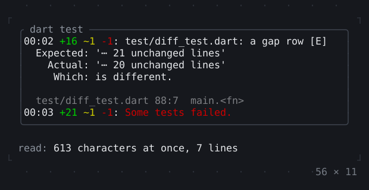
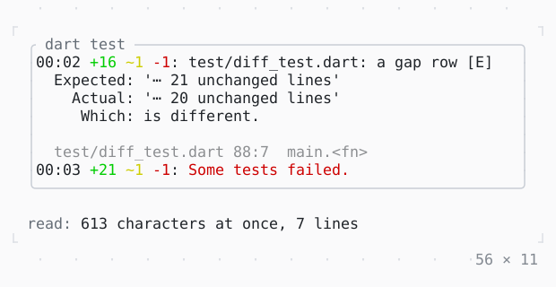

# ANSI

Output with ANSI colour codes, from a program or a log, as styled spans: all at once with parseAnsi, or as it streams in with AnsiStream.

| Dark | Light |
| --- | --- |
|  |  |

## Code

The Dart that builds it, as the gallery's Code tab shows it with the
options as they start:

```dart
// what `dart test` wrote to a terminal, its colours in SGR sequences
const _output =
    '\r\x1B[K00:00 \x1B[32m+0\x1B[0m: loading test/view_test.dart\r\x1B[K00:00 \x1B[32m+3\x1B[0m: test/view_test.dart: lists and their markers\r\x1B[K00:01 \x1B[32m+9\x1B[0m: test/stream_test.dart: a block settled once\r\x1B[K00:01 \x1B[32m+12\x1B[0m \x1B[33m~1\x1B[0m: test/code_test.dart: tabs\r\x1B[K00:02 \x1B[32m+16\x1B[0m \x1B[33m~1\x1B[0m: test/diff_test.dart: a gap row\r\x1B[K00:02 \x1B[32m+16\x1B[0m \x1B[33m~1\x1B[0m \x1B[31m-1\x1B[0m: test/diff_test.dart: a gap row [E]\n'
    '  Expected: \'⋯ 21 unchanged lines\'\n'
    '    Actual: \'⋯ 20 unchanged lines\'\n'
    '     Which: is different.\n'
    '\n'
    '  \x1B[2mtest/diff_test.dart 88:7  main.<fn>\x1B[22m\n'
    '\r\x1B[K00:03 \x1B[32m+21\x1B[0m \x1B[33m~1\x1B[0m \x1B[31m-1\x1B[0m: \x1B[31mSome tests failed.\x1B[0m\n';

final _lines = parseAnsi(_output);

@override
Widget build(BuildContext context) {
  final theme = Theme.of(context);
  return SizedBox(
    width: 56,
    child: Column(
      mainAxisSize: .min,
      crossAxisAlignment: .stretch,
      gap: 1,
      children: [
        SizedBox(
          height: 9,
          child: Box(
            border: .all(type: .rounded, style: theme.border),
            titles: [BorderTitle(' dart test ', style: theme.muted)],
            child: Column(
              crossAxisAlignment: .start,
              children: [for (final line in _lines) Text.rich(line, wrap: .none)],
            ),
          ),
        ),
        Text.rich([
          Span('read: ', theme.muted),
          Span('${_output.length} characters at once, ${_lines.length} lines'),
        ]),
      ],
    ),
  );
}
```

## Options

What the gallery lets you change, and what each starts at:

| option | values | starts at |
| --- | --- | --- |
| output | dart test, ls, log | dart test |
| read with | parseAnsi, AnsiStream | parseAnsi |
| piece | 7 chars, 16, 64 | 7 chars |

## More

- Also in Text: [Text](text.md), [Rich text](rich-text.md), [DefaultTextStyle](defaulttextstyle.md), [Right to left](right-to-left.md).
- Live in the gallery:
  `dart run packages/gallery/bin/gallery.dart --route='#/text/ansi'`.
- [Text](../text.md) · [All groups](../README.md)
