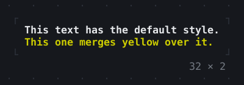
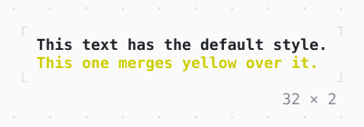

# DefaultTextStyle

The style of the text below it, which a Text merges its own over.

| Dark | Light |
| --- | --- |
|  |  |

## Code

The Dart that builds it, as the gallery's Code tab shows it with the
options as they start:

```dart
return DefaultTextStyle(
  style: const Style(attrs: Attr.bold),
  child: const Column(
    mainAxisSize: .min,
    crossAxisAlignment: .start,
    children: [
      Text('This text has the default style.'),
      Text('This one merges yellow over it.', style: .new(fg: .yellow)),
    ],
  ),
);
```

## Options

What the gallery lets you change, and what each starts at:

| option | values | starts at |
| --- | --- | --- |
| style | bold, italic, green, on navy | bold |

## More

- API: [`DefaultTextStyle`](https://pub.dev/documentation/twk/latest/twk/DefaultTextStyle-class.html).
- Also in Text: [Text](text.md), [Rich text](rich-text.md), [Right to left](right-to-left.md), [ANSI](ansi.md).
- Live in the gallery:
  `dart run packages/gallery/bin/gallery.dart --route='#/text/defaulttextstyle'`.
- [Text](../text.md) · [All groups](../README.md)
