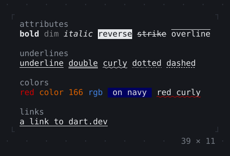
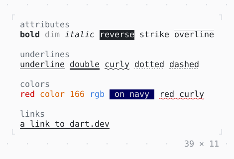

# Rich text

Spans in styles of their own: attributes, colors and links, 'text'.bold.fg(…) for short.

| Dark | Light |
| --- | --- |
|  |  |

## Code

The Dart that builds it, as the gallery's Code tab shows it with the
options as they start:

```dart
final theme = Theme.of(context);
return Text.rich([
  Span('attributes\n', theme.muted),
  'bold'.bold,
  const Span(' '),
  'dim'.dim,
  const Span(' '),
  'italic'.italic,
  const Span(' '),
  'reverse'.reverse,
  const Span(' '),
  'strike'.strike,
  const Span(' '),
  'overline'.overline,
  const Span('\n\n'),
  Span('underlines\n', theme.muted),
  'underline'.underline,
  const Span(' '),
  'double'.doubleUnderline,
  const Span(' '),
  'curly'.curlyUnderline,
  const Span(' '),
  'dotted'.dottedUnderline,
  const Span(' '),
  'dashed'.dashedUnderline,
  const Span('\n\n'),
  Span('colors\n', theme.muted),
  'red'.fg(.red),
  const Span(' '),
  'color 166'.fg(const .indexed(166)),
  const Span(' '),
  'rgb'.fg(const .rgb(64, 128, 224)),
  const Span(' '),
  ' on navy '.fg(.white).bg(const .indexed(17)),
  const Span(' '),
  const Span(
    'red curly',
    Style(attrs: Attr.curlyUnderline, underlineColor: Color.red),
  ),
  const Span('\n\n'),
  Span('links\n', theme.muted),
  'a link to dart.dev'.link('https://dart.dev').underline,
]);
```

## Options

What the gallery lets you change, and what each starts at:

| option | values | starts at |
| --- | --- | --- |
| row labels | on, off | true |

## More

- Also in Text: [Text](text.md), [DefaultTextStyle](defaulttextstyle.md), [Right to left](right-to-left.md), [ANSI](ansi.md).
- Live in the gallery:
  `dart run packages/gallery/bin/gallery.dart --route='#/text/rich-text'`.
- [Text](../text.md) · [All groups](../README.md)
