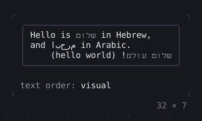
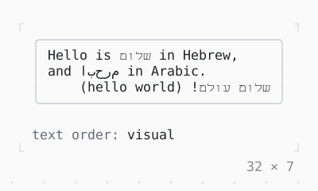

# Right to left

Hebrew and Arabic among left-to-right text: put in the order it reads where the app reorders it (TextOrder.visual), left as stored where the terminal reorders it itself.

| Dark | Light |
| --- | --- |
|  |  |

## Code

The Dart that builds it, as the gallery's Code tab shows it with the
options as they start:

```dart
import 'package:twk/twk.dart';

// The app puts right-to-left text in the order it
// reads (TextOrder.visual), for a terminal that
// shows each character in the cell it is written to.
// Without bidi, as the terminal is found to need.
Future<void> main() =>
    runApp(const RightToLeft(), bidi: BidiReordering.app);

final class RightToLeft extends StatelessWidget {
  const RightToLeft({super.key});

  @override
  Widget build(BuildContext context) {
    final theme = Theme.of(context);
    return Column(
      mainAxisSize: .min,
      crossAxisAlignment: .start,
      gap: 1,
      children: [
        SizedBox(
          width: 32,
          child: Box(
            border: .all(type: .rounded, style: theme.border),
            padding: const .x(1),
            child: const Text(
              'Hello is שלום in Hebrew,\n'
              'and مرحبا in Arabic.\n'
              'שלום עולם! (hello world)',
              align: .start,
            ),
          ),
        ),
        Text.rich([
          Span('text order: ', theme.muted),
          Span(AppBinding.of(context).textOrder.name),
        ]),
      ],
    );
  }
}
```

## Options

What the gallery lets you change, and what each starts at:

| option | values | starts at |
| --- | --- | --- |
| text order | visual, logical | visual |
| align | start, end, left, right | start |

## More

- Also in Text: [Text](text.md), [Rich text](rich-text.md), [DefaultTextStyle](defaulttextstyle.md).
- Live in the gallery:
  `dart run packages/gallery/bin/gallery.dart --route='#/text/right-to-left'`.
- [Text](../text.md) · [All groups](../README.md)
