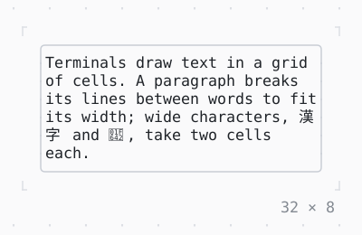

# Text

A paragraph in one style, its lines broken to fit, cut off and aligned as asked.

| Dark | Light |
| --- | --- |
|  |  |

## Code

The Dart that builds it, as the gallery's Code tab shows it with the
options as they start:

```dart
final theme = Theme.of(context);
return SizedBox(
  width: 32,
  child: Box(
    border: .all(type: .rounded, style: theme.border),
    child: Text(
      'Terminals draw text in a grid of cells. A paragraph breaks its '
      'lines between words to fit its width; wide characters, 漢字 and '
      '🙂, take two cells each.',
      wrap: .word,
      overflow: .ellipsis,
      align: .left,
    ),
  ),
);
```

## Options

What the gallery lets you change, and what each starts at:

| option | values | starts at |
| --- | --- | --- |
| wrap | word, grapheme, none | word |
| overflow | clip, ellipsis, ellipsisStart, ellipsisMiddle | ellipsis |
| align | left, center, right, justify | left |
| max lines | all, 3, 1 | all |
| width | 14 cells to 50 cells | 32 |

## More

- API: [`Text`](https://pub.dev/documentation/twk/latest/twk/Text-class.html).
- Also in Text: [Rich text](rich-text.md), [DefaultTextStyle](defaulttextstyle.md), [Right to left](right-to-left.md).
- Live in the gallery:
  `dart run packages/gallery/bin/gallery.dart --route='#/text/text'`.
- [Text](../text.md) · [All groups](../README.md)
