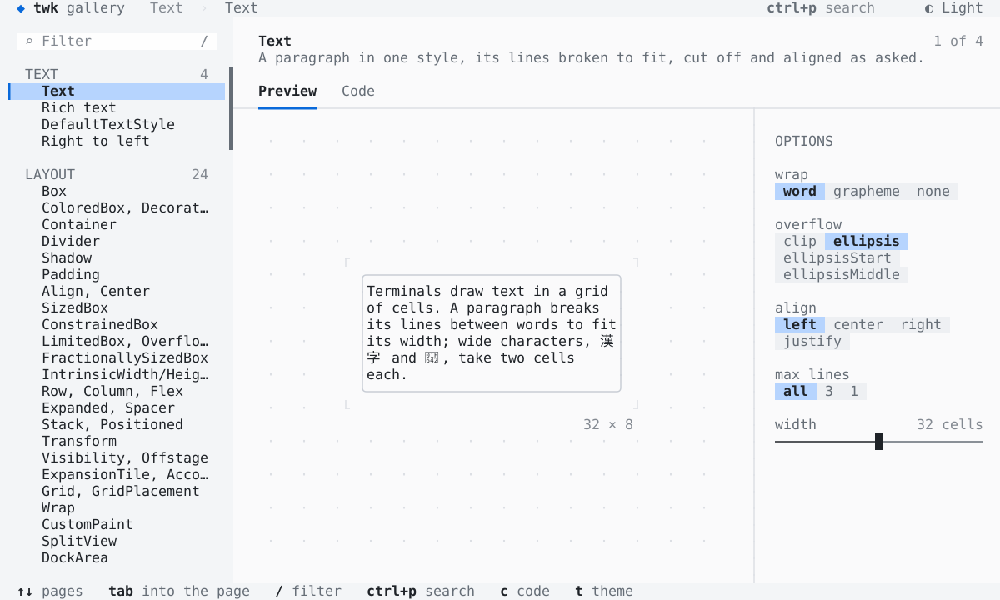
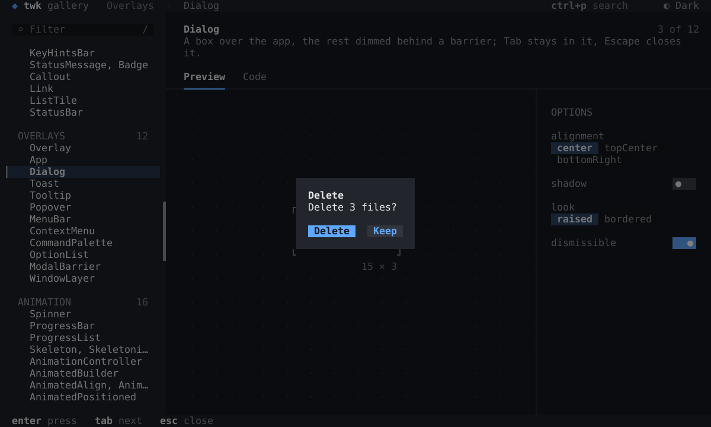
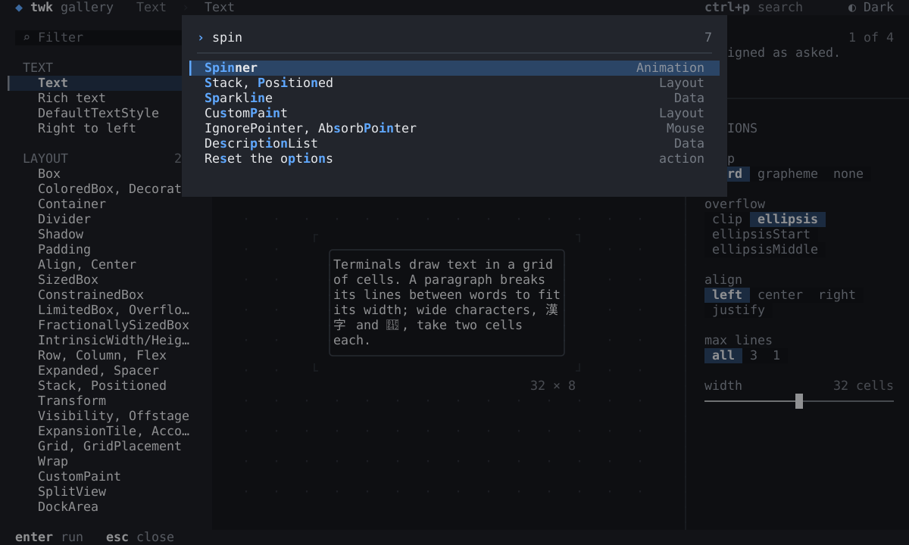

# The gallery's design

How the gallery looks and behaves, and the rules a page keeps. The
gallery is its own design: the code in `lib/` is what it does, and the
golden screens in `test/goldens/` are how every page looks, in the dark
and the light theme at 120×36 and at 80×24 (README.md, "Golden screens").
This page says why it looks so, for a change or a new page to keep to.

Until 2026-10-22 the design was a separate prototype in JavaScript
(`design/gallery`, drawn in a browser canvas in cells), which the Dart
gallery was built to match cell for cell; it did, at every page, and the
prototype was retired. The pictures below are the gallery's golden
screens as `tool/shots.dart` draws them (README.md, "Pictures"), so they
show how it looks now.

| Dark, 120×36 | Light, 120×36 |
| --- | --- |
|  |  |
|  |  |

Nothing in it is beyond a terminal: cells of one grapheme each, 24-bit
colours, the SGR attributes (bold, dim, italic, the underlines, reverse,
strike, overline), box drawing, block elements and braille.

## Layout

One row of header, one of key hints, between them a sidebar and the
page; at 120 columns the sidebar is 28 wide (22 at 80, 32 at 160). The
header, the sidebar and the hints share one tone (`chrome`), a step off
the background, so the page, on the background itself, is what is lit;
no lines are needed between them. The page: its title in bold, where it
is in its group dimmed at the right, what it is about in muted text (at
most 84 columns, three lines), then the tabs `Preview` and `Code` over a
quiet rule. Under them the stage, and the inspector at its right behind
a line joined to the rule (`┬`). The hint bar lists the focused widget's
keys, then the gallery's own that the widget does not take.

On a page narrower than 76 columns the options go under the stage, a
label column and a control each; where they would leave the widget too
little room (80×24), they take what is left, two rows at least, and
scroll: the focused option kept in view, the wheel over them, a thumb at
the right. On a screen lower than 30 rows the tabs move up to the
title's row, the chosen one in `primary`.

**The stage** shows the widget alone, centred, on a field of faint dots
(`·` every fourth column of every second row), the dots cleared around
it, its corners marked (`┌ ┐ └ ┘`) and its size under the right corner
(`48 × 4`). The marks brighten while the focus is in the widget.

**The inspector**: `OPTIONS` in small capitals, then each option, its
label above its control, a row between. Four controls: a segmented
choice (the choices on a sunken track, the chosen one raised in the
selection colour, filled with the primary colour while focused, the
highlight gliding to the new choice), a switch (a pill: `▐ ● ▌`), a
slider (twk's: a light line `─`, the thumb and the line before it in the
thumb's colour, the line after it muted, the thumb in eighths of a cell,
the value at the right of the label), colour swatches (`██` each, the
chosen one underlined `▔▔`, its name at the right of the label). The
focused option has its label bold and a primary bar `▎` at its left. An
option that does not apply with the others as they are is dim, and Tab,
the keys and the mouse pass it by. In the narrow layout, two switches in
a row have a blank row between them. The hint bar shows twk's hints for
each control: a choice and the swatches `← previous` `→ next`, a switch
`space toggle`, a slider `← decrease` `→ increase`.

**The palette** (Ctrl+P): a row from the top, ranked by twk's
`fuzzyMatch`, ties by when each was last run, then by list order; with
nothing typed, the ones run before come first.

## Colour

twk's `ThemeData` presets as they are (dark, light, nord,
catppuccinMocha, catppuccinLatte), then the terminal's own colors
(`ThemeData.terminal` of the terminal's brightness, where each token
falls back to the slot it starts from), and tokens derived from their
slots by mixing (`mix(a, b, k)` is `Color.lerp`; `lib/src/shell/tokens.dart`):

| Token | Dark themes | Light themes | Used for |
| --- | --- | --- | --- |
| `chrome` | `mix(background, surface, .5)` | `mix(background, surface, .55)` | header, sidebar, hints, code panel (light) |
| `well` | `mix(background, black, .12)` | `mix(background, white, .7)` | the filter field, segment tracks, code panel (dark) |
| `faint` | `mix(background, border, .55)` | `mix(background, border, .6)` | the stage's dots and marks, quiet rules |
| `dim` | `mix(muted, background, .2)` | the same | counts, line numbers, sizes, shortcuts in the list |
| `selectionIdle` | `mix(selection, background, .35)` | the same | the selection of what has not the focus |
| `onPrimary` | `background` | white | text on a primary fill |
| barrier | black at .5 | black at .28 | under a dialog or the palette (×.75) |

One accent: `primary`, for what has the focus and what is chosen (the
selection's bar `▎`, the tab's underline, a focused control, matches in
the filter and the palette). `accent` and the status colours appear only
in examples and code.

**Scroll thumbs** in `muted`, as twk's `Scrollbar` draws them.

**Type.** Titles bold in `text`; what a thing is about in `muted`;
section labels (groups, `OPTIONS`) upper case in `muted`; counts and
sizes in `dim`; keys bold in `text`, their hints `muted`.

**Borders.** Rounded (`╭╮╰╯`) for the boxes inside a page (a Text's box,
a field). A surface that floats (dialog, palette, toast) has no outline:
it is the surface colour, a cell of room around its content, over a
barrier or with a shadow. Lines that meet join, as a merged twk Divider
joins them.

**Focus is always visible**, by one of two rules: a filled control
(button, segment, table cell) fills with `primary`, its text
`onPrimary`; a row (list item, checkbox, switch row, palette match,
option) takes the `selection` background, and a list's or an option's
row a `primary` bar `▎` at its left. What is selected but not focused
takes `selectionIdle` and the bar turns `muted`. A Table's and a
Calendar's cursor is `primary` reversed: its text in the cell's
background colour, as twk's default cursor style draws it. The
terminal's cursor shows in a field, the filter and the palette: a bar,
or the shape a field's `cursorShape` asks for.

## Motion

Motion explains, and is short (ease-out unless said; `lib/src/motion.dart`):

| What | How | ms |
| --- | --- | --- |
| a new page | backgrounds at once; each glyph fades in from the background at a time of its own (no two pages' text ever mix) | 300 |
| Preview ↔ Code | the same, over the body | 300 |
| the theme | every colour cross-fades (ease-in-out) | 280 |
| the list's selection | the bar glides to the new row | 70 + 18 a row, at most 220 |
| the list's scroll | glides | 160 |
| the tab underline | glides under the new tab | 160 |
| a segmented choice | the highlight glides to the new choice | 140 |
| a switch | the knob runs, the track's colour fades | 130–140 |
| a slider | the thumb runs | 90 |
| a toast | slides in from the right edge; fades into what is under it, its shadow with it | 200, 260 |
| an Overlay entry | fades in, and out | 160, 120 |
| a popover | fades in, and out | 120, 100 |
| a menu | fades in | 90 |
| the palette | the barrier and the panel fade in | 140 |
| a dialog | the barrier and the dialog fade in; the answer is lit and fades | 160, 900 |
| a button press | flashes lighter | 260 |
| an option's effect on the code | the lines it changed are lit and fade | 900 |

Frames are drawn only when asked for: an animation asks for the next
one, a spinner or a live sparkline for the time of its next step. A
route's `t=` stops the gallery's clock: every motion is at its end, and
a page that moves with time shows that moment.

## The mouse

Only the left button presses. A click chooses a page, focuses and
presses what it is on, sorts a table by a title; a press drags a table
column's edge. The wheel scrolls the list, the code and the options, and
moves the palette's highlight. A slider press on the thumb grabs it,
elsewhere moves it there; a drag moves it with the mouse, in eighths of
a cell. The code view takes no focus from a press. A press on the
palette's barrier closes it on release.

The mouse selects in the code with twk's `SelectionArea`, as in a Text:
a drag selects the characters between two cells, those of both cells
too, across lines; a double click the word (or the run of blanks), a
triple click the line, and a drag after either goes on by words or by
lines; a click clears it. It is drawn in the `selection` colour under
the highlighting. A drag past the top or bottom of the view scrolls it,
every 50 ms by the rows it is past (3 at most), and past its left or
right edge sideways, by the columns; the wheel scrolls while something
is selected. The release that selected something copies it (OSC 52) and
toasts `Copied 3 lines` (`Copied 5 characters` within a line). What is
copied is the code's own text: no line numbers, its line breaks, the
blanks that end a line dropped. Another page, the other tab, a change of
the code by an option or Escape clears the selection; `y` copies it, or
the whole code when nothing is selected.

## What every page keeps

- **What happened** is a line under the widget, `label: value` —
  `chosen:`, `answer:`, `picked:`, `submitted:`, `selected:`, `copied:`,
  `heard:`, `ran:`, `did:` — the label `muted`, the value `text`,
  `nothing` (muted) before anything happened; a new value is lit and
  fades (900 ms, `LitLine`). A log that is empty says `nothing yet`. The
  Code builds the line too: the label a `Span` in `theme.muted`. The fade
  is the gallery's own; no other highlight is drawn that the Code does
  not build.
- **Options** are named in lower-case words (`double tap`, `copy on
  release`, `back key`); a value that is a twk name keeps it
  (`topRight`, `easeInOut`, `spaceBetween`, `vertical`); fractions are
  `¼ ½ ¾`; times `500 ms`, `1 s`.
- **Hints** are the ones twk's widgets give: a button's `enter press`, a
  switch's `space toggle`, a slider's `← decrease` `→ increase`. Where
  twk gives none, the page writes them (`PageHints`): `↑↓ scroll`, `pgup
  pgdn a window`, `home end the ends`, `shift+←→ width`.
- **Buttons** flash on a press, by the mouse or by Enter and Space.
- **Boxes** inside a page are rounded and in `border`, `primary` while
  the focus is in them (`FocusBuilder`); floating panels and windows
  have no outline (raised surface, a shadow where the widget gives one).
- **Sizes**: a Column or Row the stage sizes says `mainAxisSize: .min`.
  The stage's room is loose and bounded, and under it twk's default
  `MainAxisSize.max` fills the room. A widget fits in 50 × 12 cells or
  says how it shrinks (`heightIn`); MarkdownView, CodeView, DiffView and
  TerminalView take the stage's room (`StageSize.room`).
- **Themes**: it is legible in all five.
- **Sample data**: the user is `user` (`user@twk`, `/home/user/twk`), the
  project `twk`, the date 19 October 2026; nothing names a real person.
