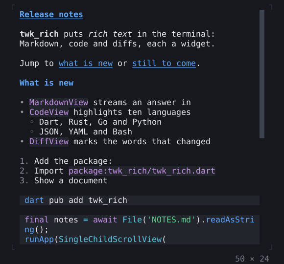

# twk_rich

Markdown, syntax highlighting, diffs, JSON trees, big text, QR codes and
images for terminal apps built with [twk](https://pub.dev/packages/twk). It
is a package of its own, so an app that shows none of this does not carry
it.



## Features

- **Markdown:** `MarkdownView` shows CommonMark and GitHub's tables, task
  lists and strikethrough, with links, highlighted code and text to select.
  `MarkdownStream` takes a document as it arrives, such as a model's answer.
- **Code:** `CodeView` with line numbers, search and selection, for Dart,
  JSON, YAML, shell, JavaScript, TypeScript, Python, Rust, Go and diffs.
- **Diffs:** `DiffView`, unified or side by side, reads the output of `git diff`
  and marks the words that changed.
- **JSON:** `JsonView` shows a document or a Dart value as a tree that folds,
  with a filter and the path of a value to copy.
- **Big text:** `BigText` for splash screens, clocks and dashboards.
- **QR codes:** `QrCode`, drawn in cells, for a phone to read.
- **Images:** `Image` shows PNG and JPEG files over kitty, iTerm2 or sixel,
  and in block characters where the terminal has no graphics. It is a library
  of its own, `package:twk_rich/image.dart`.

## Getting started

```sh
dart pub add twk twk_rich
```

A document that scrolls, its text selected with the mouse, q to quit:

```dart
import 'package:twk/twk.dart';
import 'package:twk_rich/twk_rich.dart';

const text = '''
# Notes

Markdown in a terminal: *emphasis*, **strong**, `code`, [links](https://dart.dev)
and lists:

- one
- two
''';

Future<void> main() => runApp(const Notes());

final class Notes extends StatelessWidget {
  const Notes({super.key});

  @override
  Widget build(BuildContext context) => KeyBindings(
    {'q': () => AppBinding.of(context).quit()},
    child: const SelectionArea(
      child: SingleChildScrollView(child: MarkdownView(text)),
    ),
  );
}
```

## Learn more

- [Examples](https://github.com/pro100andrey/twk/blob/main/packages/twk_rich/example/README.md):
  a viewer of Markdown files and diffs, a chat that streams its answers, and
  an image viewer.
- [Widget catalog](https://github.com/pro100andrey/twk/blob/main/doc/widgets/rich.md):
  each widget with a picture and its code.
- [Reference](https://github.com/pro100andrey/twk/blob/main/packages/twk_rich/doc/reference.md):
  what each library provides, in full.
- [Images](https://github.com/pro100andrey/twk/blob/main/packages/twk_rich/doc/images.md):
  decoding, scaling and the terminals' protocols.
- [How it is tested](https://github.com/pro100andrey/twk/blob/main/packages/twk_rich/doc/internals.md):
  for those who work on the package.

## License

MIT, copyright 2026 Andrii Ivanov: [LICENSE](LICENSE). The CommonMark and
GFM spec examples the Markdown tests run (`test/markdown/spec.json` and
`gfm.json`) are under CC BY-SA 4.0, as the specs are: [NOTICE](NOTICE).
The big-text fonts were drawn for this package and are MIT like the rest
of it.

`package:twk_rich/image.dart` is based in part on the work of the
Independent JPEG Group. Its JPEG decoder's integer IDCT, its YCbCr to RGB
tables and its refinement of progressive AC coefficients are translated
from libjpeg and keep the IJG's licence, whose README is
[README.ijg](README.ijg). Its walk through a scan, its decoding of the
blocks of baseline scans and of progressive scans' first passes, and its
colour transform of three components follow jpgjs, as pdf.js keeps it
(Apache License 2.0) and as package:image ports it to Dart (MIT License),
and keep those licences. [NOTICE](NOTICE) names the files and lines each
part follows and what was changed, and carries the licences. They apply
to an executable only where it imports `package:twk_rich/image.dart`;
one that imports `package:twk_rich/twk_rich.dart` alone compiles none of
that code.
