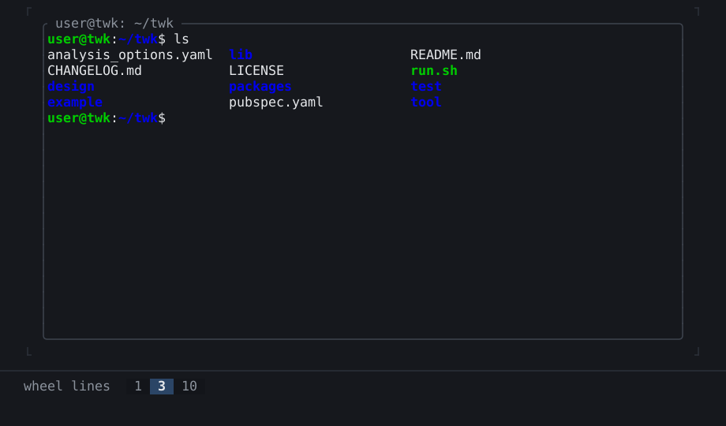

# twk_term

A terminal inside a [twk](https://pub.dev/packages/twk) app. Run a shell, an
editor or any program in a widget, next to the rest of your interface.



## Features

- **`TerminalView`:** shows a running program and gives it the keys, the
  mouse, pasted text, the focus and its size.
- **Real programs:** shells, `less`, `nano` and `htop` run in it, with colors,
  the alternate screen, bracketed paste and the kitty keyboard protocol.
- **Pseudo-terminals:** `Pty` starts a program in one, through `dart:ffi`
  alone. It runs on Linux and macOS.
- **Your own link:** a `TerminalSession` can run over any byte stream, such as
  a scripted program or a remote shell.
- **An emulator of its own:** `TerminalEmulator` turns a program's output into
  cells and its keys into bytes, for a host that is not a twk app.

## Getting started

```sh
dart pub add twk twk_term
```

A shell in the whole terminal. The app quits when the shell ends, so type
`exit` to leave:

```dart
import 'package:twk/twk.dart';
import 'package:twk_term/twk_term.dart';

Future<void> main() => runApp(const Shell());

final class Shell extends StatefulWidget {
  const Shell({super.key});

  @override
  State<Shell> createState() => _ShellState();
}

final class _ShellState extends State<Shell> {
  // started at the view's size, at its first layout
  final _session = TerminalSession.start('bash', const []);

  @override
  void initState() {
    super.initState();
    _session.addListener(() {
      if (_session.ended) {
        AppBinding.of(context).quit();
      }
    });
  }

  @override
  void dispose() {
    _session.dispose(); // hangs up: SIGHUP for bash
    super.dispose();
  }

  @override
  Widget build(BuildContext context) =>
      TerminalView(session: _session, autofocus: true);
}
```

## Learn more

- [Examples](https://github.com/pro100andrey/twk/blob/main/packages/twk_term/example/README.md):
  two shells side by side in a `SplitView`.
- [Widget catalog](https://github.com/pro100andrey/twk/blob/main/doc/widgets/terminal/terminalview.md):
  `TerminalView` with a picture and its code.
- [The view](https://github.com/pro100andrey/twk/blob/main/packages/twk_term/doc/view.md):
  `TerminalSession` and `TerminalView`, in full.
- [The pseudo-terminal](https://github.com/pro100andrey/twk/blob/main/packages/twk_term/doc/pty.md):
  `Pty`, signals and the environment.
- [What it emulates](https://github.com/pro100andrey/twk/blob/main/packages/twk_term/doc/emulation.md):
  the sequences, modes and keys the emulator speaks.
- [The host interface](https://github.com/pro100andrey/twk/blob/main/packages/twk_term/doc/host-interface.md):
  the emulator alone, for a host of its own.
- [How it is tested](https://github.com/pro100andrey/twk/blob/main/packages/twk_term/doc/internals.md):
  and how fast it is, for those who work on the package.

## License

MIT, copyright 2026 Andrii Ivanov: [LICENSE](LICENSE).
